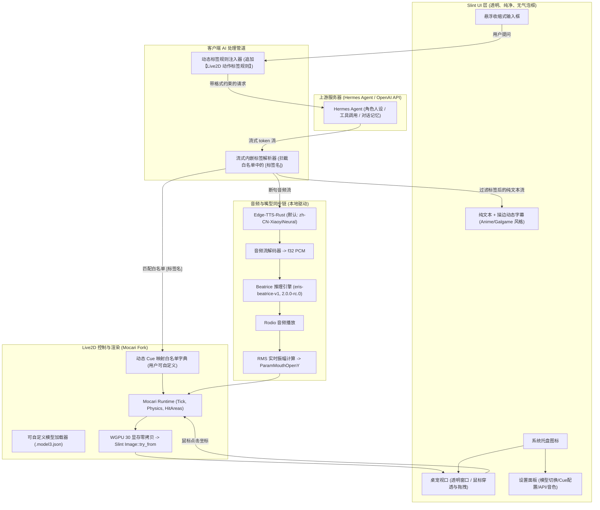

# Murasame 桌面宠物（Live2D + AI + TTS）系统开发计划 (v1.2)

## 项目定位与设计哲学
本软件定位为 **轻量、高性能、高度可定制的 AI 桌面宠物前端客户端**，后端直接连接用户部署的 **Hermes Agent** 或任何兼容 **OpenAI 格式** 的大模型服务。

客户端自身**不绑定特定的角色人设/背景设定**（人设与记忆由上游 Agent 服务端统一管理），而是专注于：
1. **多模型驱动**：支持加载用户自定义的 Live2D 模型（默认提供丛雨 `Murasame_live2d` 进行开箱即用测试）；
2. **极简动态 Cue 系统**：自动解析模型动作与表情并允许用户自由配置 Cue 别名，标签统一使用最自然的 **`[标签名]`** 格式（如 `[smile]`、`[greet]`），不带任何语法冗余前缀；
3. **白名单流式解析**：流式状态机基于已注册的 Cue 白名单精确拦截动作标签，普通方括号文本（如引用 `[1]` 或 Markdown 链接）原样保留；
4. **显存零拷贝渲染**：基于 WGPU 30 与 Slint `unstable-wgpu-30`，实现 GPU 显存直通渲染；
5. **极简优雅 UI/UX**：无气泡框遮挡的“纯文本 + 描边”悬浮字幕、可收纳输入条、系统托盘；
6. **本地语音链条**：Edge-TTS（默认 `zh-CN-XiaoyiNeural`） + Beatrice VC（默认 `eris-beatrice-v1`） + 实时口型同步。

---

## 核心架构流程图



---

## 详细模块方案

### 模块一：动态 Cue 与自定义 Live2D 模型系统

#### 1. 模型加载与自动发现机制
- 软件支持在配置中指定任意 Live2D 模型路径（默认：`./Murasame_live2d/Murasame.model3.json`）。
- **初始化自动扫描**：
  - 读取 `.model3.json` 中的 `FileReferences.Expressions` 与 `FileReferences.Motions`。
  - 为每个表情与动作自动提取默认键名（如 `exp1`, `motion02`）。
  - 读取 `HitAreas`（如 `face`, `hair`, `xiongbu` 等）以及对应的触发动作。

#### 2. 用户可编辑的动态 Cue 映射表（`config.toml`）
标签直接采用原生语义名，例如 `[smile]`、`[greet]`：
```toml
[model]
path = "Murasame_live2d/Murasame.model3.json"
scale = 1.0

# 用户自定义的语义 Cue 映射（直接作为 [xxx] 标签匹配）
[cues.expressions]
smile = "exp1.exp3"
angry = "exp2.exp3"
sad = "exp3.exp3"
dark = "exp4.exp3"
panic = "exp5.exp3"
shy = "exp6.exp3"
smug = "exp7.exp3"
neutral = "exp0.exp3"

[cues.motions]
greet = "motion02.motion3.json"
talk = "motion03.motion3.json"
show = "motion04.motion3.json"
relieved = "motion05.motion3.json"
deny = "motion08.motion3.json"
pout = "motion10.motion3.json"
morning = "motion11.motion3.json"

# 点击热区交互绑定
[interactions.hit_areas]
face = "Tapface"
hair = "Taphair"
xiongbu = "Tapxiongbu"
qunzi = "Tapqunzi"
leg = "Tapleg"
```

---

### 模块二：精简客户端 System Prompt 动态生成规则

客户端只追加动态生成的格式约束，避免破坏服务端的原生 Prompt：

#### 动态生成的 Prompt 模板
```text
【Live2D 实时动作与表情嵌入规则】
在流式回复时，你可以在合适的位置直接嵌入动作与表情标签，格式为：`[标签名]`。
桌宠引擎会实时捕获该标签并触发对应的表情与肢体动作。请自然地将标签嵌入在句首或情感变化处，切勿附加多余的解释。
当前模型支持的可用标签：
- 表情标签：{DYNAMIC_EXPRESSION_CUES}
- 动作标签：{DYNAMIC_MOTION_CUES}

示例：
“[morning][smile]早上好！今天也是元气满满的一天呢。[greet]”
```
*客户端启动时自动将 `{DYNAMIC_EXPRESSION_CUES}` 替换为 `[smile], [angry], [sad], [shy]...`，将 `{DYNAMIC_MOTION_CUES}` 替换为 `[greet], [talk], [deny], [pout]...`。*

#### 白名单流式解析机制（杜绝误触）
- 流式解析器只对**白名单内的有效 Cue 名**进行拦截和剥离；
- 如果 AI 输出了非白名单的方括号（如文献引用 `[1]`、代码块 `[index]` 或 Markdown 链接 `[text](url)`），解析器直接放行，完整在字幕中正常显示。

---

### 模块三：UI / UX 升级（纯文本 + 描边字幕）

彻底抛弃传统矩形气泡框，采用纯净悬浮的“纯文本 + 高对比描边”设计：

```slint
// 悬浮描边字幕实现
component SubtitleText inherits Text {
    in property <string> subtitle_content;
    
    font-size: 18px;
    font-weight: 700;
    color: #ffffff;
    horizontal-alignment: center;
    wrap: word-wrap;
    
    // Slint 文本描边配置
    stroke: #1a1a1acc;
    stroke-width: 1.5px;
}
```
- **视觉特性**：
  - **无框体遮挡**：模型周围无任何气泡框或遮挡层，保持干净通透；
  - **双层高对比度**：主体纯白 (`#ffffff`) + 柔和暗色高对比描边 (`#1a1a1a`) + 投影，在任何复杂桌面壁纸下都清晰可读；
  - **动态生命周期**：随流式生成打字机渐显，语音播放完毕后停留 4 秒平滑淡出。

---

### 模块四：音频管道与 Beatrice 变声配置

1. **Edge-TTS 引擎**：
   - 默认音色：`zh-CN-XiaoyiNeural`。
   - 备选支持：`zh-CN-XiaoxiaoNeural`、`ja-JP-NanamiNeural` 等，支持界面切换。
2. **Beatrice 变声模型**：
   - 默认模型路径配置为：`C:\Users\Initsnow\Documents\eris-beatrice-v1`。
   - 加载其下的 `beatrice_paraphernalia_data_00010000.toml`（版本 `2.0.0-rc.0`，Speaker: `Eris`）。
   - 复用 `edge-tts-android\rust` 的 `BeatriceRC0` C-FFI 绑定。
3. **实时口型同步**：
   - 播放 PCM 音频时计算滑动窗口 RMS 能量值；
   - 经 Gain 缩放后平滑插值写入 Mocari 的 `ParamMouthOpenY`。

---

### 模块五：WGPU 30 显存零拷贝渲染设计

- **`Cargo.toml` 依赖**：
  - `mocari = { path = "submodules/mocari", features = ["wgpu"] }` (依赖 `wgpu = "30.0.0"`)
  - `slint = { version = "~1.18", features = ["unstable-wgpu-30", "renderer-winit-femtovg", "renderer-winit-vello"] }`
- **渲染直通链路**：
  - Mocari 直接将 Live2D 画面渲染至专用的 `wgpu::Texture`；
  - 调用 `slint::Image::try_from(texture)` 包装为 Slint 图片属性；
  - 数据 100% 留存于 GPU VRAM，完全消除 CPU-PCIe 内存往返开销，稳定 60 FPS 运行。

---

## 阶段实施计划

| 阶段 | 核心任务 | 交付物 |
| :--- | :--- | :--- |
| **P1** | Submodule 引入 `Initsnow/Mocari`，配置 `Cargo.toml` (Slint unstable-wgpu-30 + WGPU 30) | 工程骨架与编译通过 |
| **P2** | 封装模型通用加载器、动态 `[标签名]` 映射解析、WGPU 显存零拷贝渲染桥接 | 桌面窗口渲染 Live2D 并响应点击 |
| **P3** | 移植 `beatrice` FFI，接入 `eris-beatrice-v1`，实现 Edge-TTS (`XiaoyiNeural`) + VC + 口型同步 | 能够通过代码触发语音朗读并张嘴 |
| **P4** | 接入 `async-openai` 客户端，动态生成 `[标签名]` 规则 Prompt，实现白名单流式标签剥离 | 接入 Hermes Agent 验证标签触发 |
| **P5** | 编写 Slint “纯文本+描边”悬浮字幕、收纳输入栏、托盘与设置面板 | 完整 GUI/UX 体验 |
| **P6** | 全链路联调测试与参数调优 | 稳定可发布的桌面端产品 |
